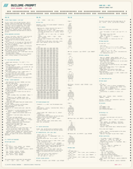
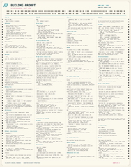
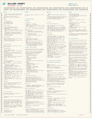

# Space Invaders — Last Line

**Play online:** [crinklebine.github.io/space-invaders](https://crinklebine.github.io/space-invaders/)

A neon-drenched, single-file take on Space Invaders, presented inside a portrait arcade cabinet. Hold the last line through escalating waves of invaders, crumbling bunkers, and falling bombs — and watch for the mystery UFO. Most saucers go down in one shot, but a rare armored variant deflects your first hit and pays **1,000 points** when you finish it off.

## Play

Play in your browser at **https://crinklebine.github.io/space-invaders/**, or open `index.html` locally. No build step, server, or external dependencies.

## Controls

| Input | Action |
| --- | --- |
| `←` / `→` or `A` / `D` | Move |
| `Space` | Fire |
| `P` / `Esc` | Pause / resume |
| `M` | Sound on/off |
| `Enter` | Play / play again / resume |
| `Q` | Title screen (pause or game over) |
| `I` | System info (title screen, or tap the info icon) |
| `R` | Reset high score (system info, or tap RESET HIGH SCORE) |
| `Y` / `N` | Confirm / cancel reset (or tap YES / NO) |

Touch controls appear automatically on mobile devices.

## Features

- 55-invader formations with escalating waves and speed
- Destructible bunkers, animated bombs, and shot-versus-bomb duels
- Rare armored UFO (10% of spawns) with a two-hit, 1,000-point bonus
- Persistent high score and a hidden build/system info panel
- Responsive 7:8 portrait cabinet with CRT scanlines, glow, and screen shake

## Saved data

High score and sound preference live in this browser's `localStorage`:

- Game name: `last-line`
- Storage hash: `79b111`
- Storage ID: **`last-line-79b111`**
- High score: `si.last-line-79b111.hi`
- Sound: `si.last-line-79b111.sound`

`GAME_NAME` and `GAME_HASH` are defined once in `index.html`; `GAME_ID` combines them. Keep the hash unchanged after release so existing scores survive updates. When testing a separate variant, give it a new name and hash so it cannot share this game's data. The hidden system info panel displays the active `GAME_ID`. Only keys under the active `GAME_ID` are read or written. High scores are written only when a run reaches game over. Choosing **TITLE SCREEN** from pause abandons the run, and its score is not saved; if the run has beaten the stored best, the pause screen marks it **[HIGH SCORE LOST]** in yellow. Open system info with `I` or the title-screen info icon, then press `R` or tap **RESET HIGH SCORE**. Confirm with `Y` / **YES, RESET**, or cancel with `N` / **NO, KEEP SCORE**.

## Build Me punch cards

The `punchcards` folder contains the full build prompt as three character-accurate cards. Copy all three card images into an AI assistant and simply say **“Build Me”**. A text version is also available at [BUILDME-PROMPT.md](BUILDME-PROMPT.md). Click a thumbnail to open the full-resolution card.

<table>
  <tr>
    <td align="center" width="33%"></td>
    <td align="center" width="33%"></td>
    <td align="center" width="33%"></td>
  </tr>
</table>

## License

Licensed under the [GNU General Public License v3.0](LICENSE).
