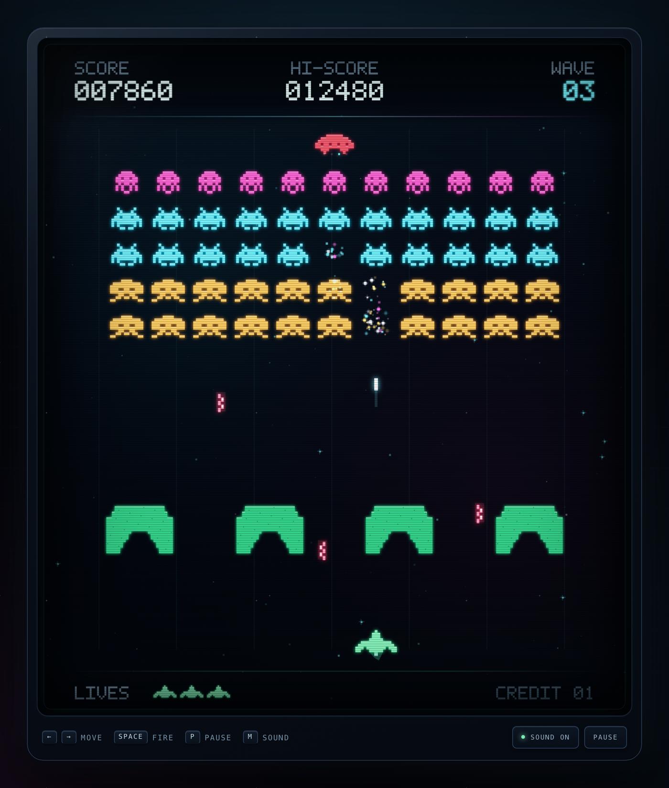

# Space Invaders — Last Line

**Play online:** [crinklebine.github.io/space-invaders](https://crinklebine.github.io/space-invaders/)

A neon-drenched, single-file take on Space Invaders, presented inside a portrait arcade cabinet. Hold the last line through escalating waves of invaders, crumbling bunkers, and falling bombs — and watch for the mystery UFO. Most saucers go down in one shot, but a rare armored variant deflects your first hit and pays **1,000 points** when you finish it off.

## Play

Play in your browser at **https://crinklebine.github.io/space-invaders/**, or open `index.html` locally. No build step, server, or external dependencies.

## Controls

| Input | Action |
| --- | --- |
| `←` / `→` or `A` / `D` | Move |
| `Space` | Fire |
| `P` / `Esc` | Pause |
| `M` | Sound on/off |
| `Enter` | Start / restart |
| `I` | System info (start screen) |

Touch controls appear automatically on mobile devices.

## Features

- 55-invader formations with escalating waves and speed
- Destructible bunkers, animated bombs, and shot-versus-bomb duels
- Rare armored UFO (10% of spawns) with a two-hit, 1,000-point bonus
- Persistent high score and a hidden build/system info panel
- Responsive 7:8 portrait cabinet with CRT scanlines, glow, and screen shake

## Saved data

High score and sound preference live in this browser's `localStorage`:

- Game name: `last-line`
- Storage hash: `79b111`
- Storage ID: **`last-line-79b111`**
- High score: `si.last-line-79b111.hi`
- Sound: `si.last-line-79b111.sound`

`GAME_NAME` and `GAME_HASH` are defined once in `index.html`; `GAME_ID` combines them. Keep the hash unchanged after release so existing scores survive updates. When testing a separate variant, give it a new name and hash so it cannot share or inherit this game's data. The hidden system info panel displays the active `GAME_ID`. Old `si.last-line.*` and shared `si_hi` values are imported once on first load.

## License

Licensed under the [GNU General Public License v3.0](LICENSE).
